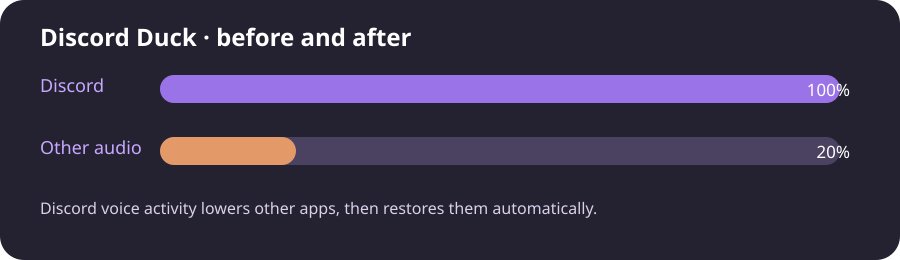

# Discord Audio Ducking for Linux and Windows


## Clone the repository

```bash
git clone https://github.com/Aracellii/Discord_Duck.git
cd Discord_Duck
```

Discord Duck is an open-source Discord audio ducking utility for Linux and Windows. It automatically lowers other application audio while someone is speaking in Discord.

[English](README.md) · [Bahasa Indonesia](linux/README.id.md) · [Español](linux/README.es.md) · [简体中文](linux/README.zh-CN.md)

[Linux](linux/README.md) · [Windows](windows/README.md) · [Changelog](CHANGELOG.md)



## Features

- Global ducking for every non-Discord audio session.
- Discord, Vesktop, and WebCord audio stays at normal volume.
- Persistent on/off toggle from the terminal.
- Adjustable voice sensitivity and release duration.
- Linux daemon with systemd user service.
- Windows daemon with Task Scheduler and Windows Audio Session API.
- Per-application volume restoration after ducking.
- MIT licensed and open source.

## Before and after

| Situation | Discord | Other applications |
| --- | ---: | ---: |
| No one is speaking | 100% | 100% |
| Someone is speaking | 100% | 20% |
| Voice stops after release duration | 100% | Restored |

## Platforms

- [Linux](linux/README.md) — PipeWire/PulseAudio daemon with systemd user service.
- [Windows](windows/README.md) — Windows Audio Session API daemon with Task Scheduler.

Both versions support persistent terminal controls for enable, disable, toggle, sensitivity, and release duration.

## Troubleshooting

### The command is not found

Linux:

```bash
export PATH="$HOME/.local/bin:$PATH"
```

Windows: open a new PowerShell window after running the installer so the updated user PATH is loaded.

### Discord is not detected

Make sure Discord is playing audio through the same output device as the other applications. For Linux, verify that `pactl list sink-inputs` shows a Discord stream. For Windows, verify that Discord appears in the Windows volume mixer.

### Other audio stays quiet

Use the toggle to disable and re-enable the daemon:

```bash
discord-duck --disable
discord-duck --enable
```

The daemon stores the original per-application volume and restores it after the release duration.

## License

MIT License. See [LICENSE](LICENSE).
